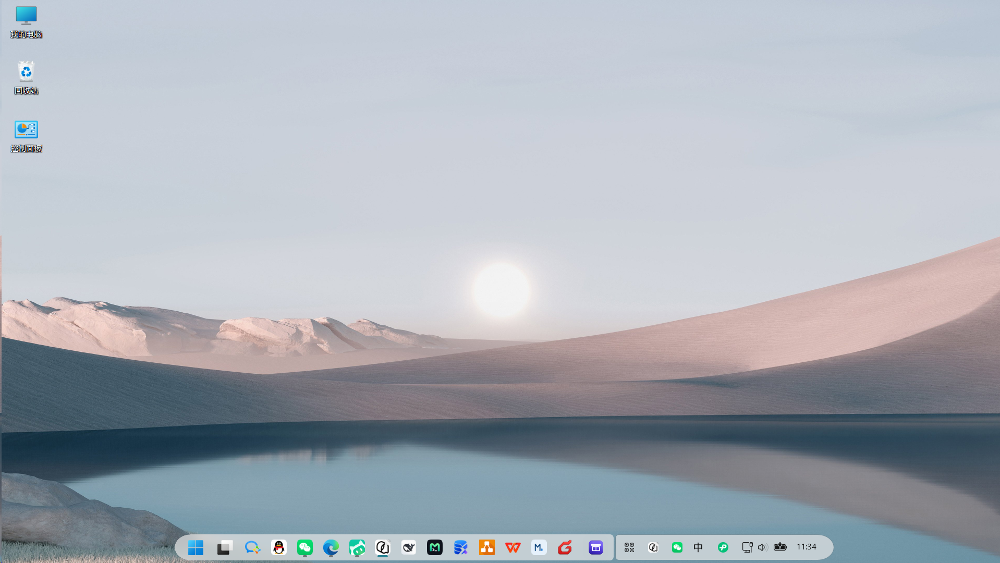
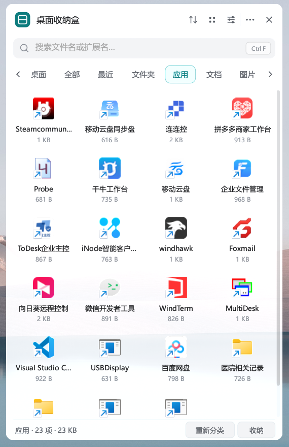
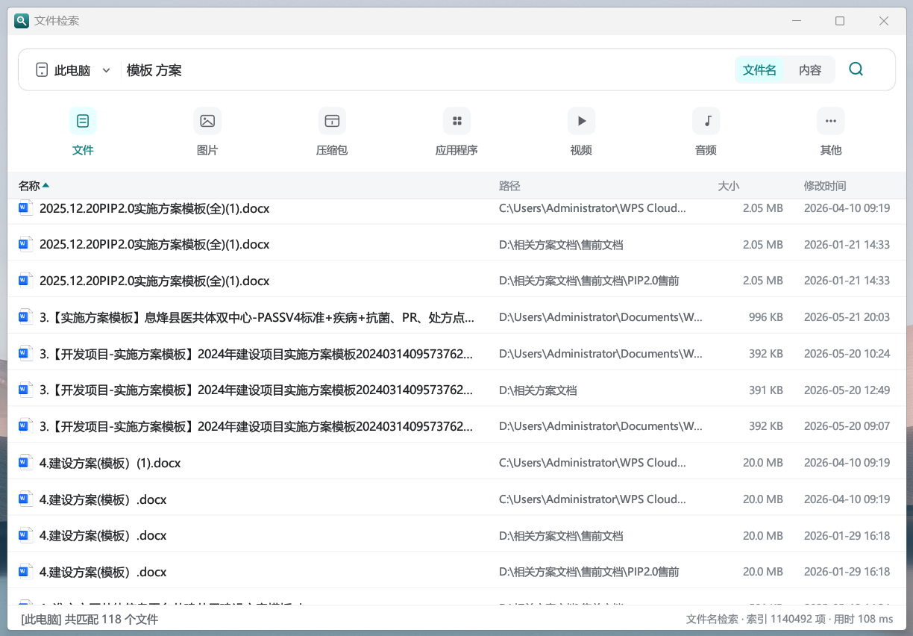
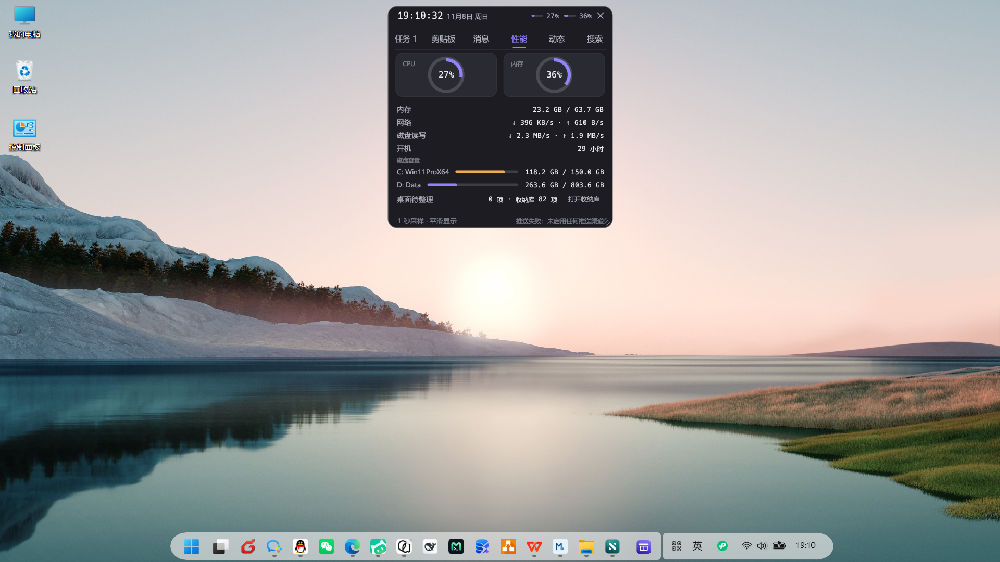
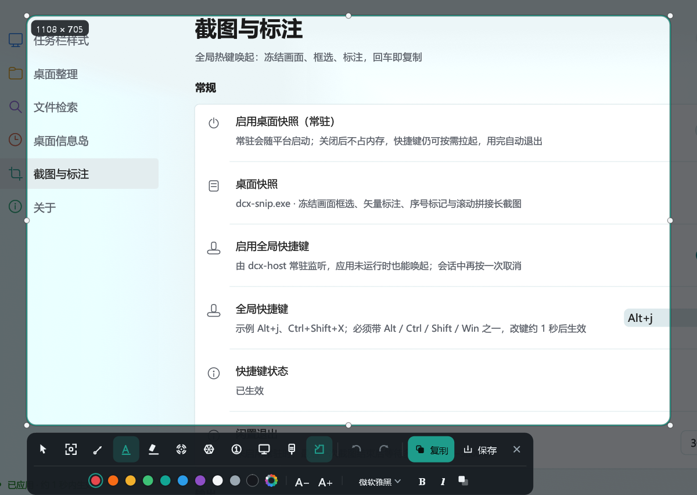
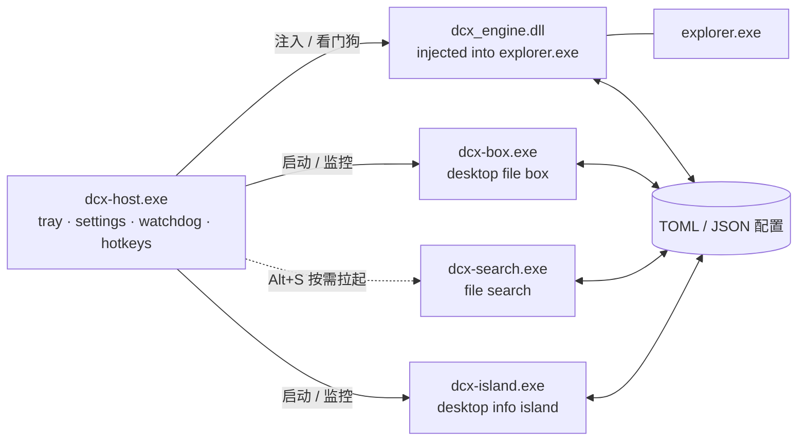

<p align="center">
  
</p>

<h1 align="center">DCX</h1>

<p align="center">
  <b>Windows 11 桌面增强平台</b><br>
  任务栏主题 · 桌面收纳盒 · 文件检索 · 桌面信息岛 · 桌面快照
</p>

<p align="center">
  <a href="https://github.com/gggaiitx/dcx/releases/latest"></a>
  
  
  <a href="LICENSE"></a>
</p>

DCX 是一套用 Rust 编写的 Windows 11 桌面增强平台。它把五件事做成彼此独立的进程：**任务栏主题**、**桌面收纳盒**、**文件检索**、**桌面信息岛**、**桌面快照**。宿主常驻托盘，负责注入看门狗、应用生命周期、全局热键和统一设置中心；应用崩溃不会带走宿主，宿主退出会统一停止应用。

> 当前版本 **v0.1.3**，已在 Windows 11 `10.0.26200` x64 实机验证。任务栏引擎针对当前 Win11 视觉树实现，Windows 大版本更新后可能需要重新核对元素路径。

## 效果

<p align="center">
  
</p>
<p align="center"><sub>任务栏主题与桌面收纳盒按钮</sub></p>

<p align="center">
  
</p>
<p align="center"><sub>桌面收纳盒：应用分类视图</sub></p>

<p align="center">
  
</p>
<p align="center"><sub>文件检索：名称 / 路径 / 大小 / 修改时间</sub></p>

<p align="center">
  
</p>
<p align="center"><sub>桌面信息岛：时钟、性能、任务、剪贴板、消息、动态、搜索六个页签</sub></p>

<p align="center">
  
</p>
<p align="center"><sub>桌面快照：两行标注工具条与「截图与标注」设置页</sub></p>

## 功能

| 模块 | 能力 |
|---|---|
| **任务栏主题** | 胶囊 / 卡片两种 dock 形态；图标缩放 50–125%；间距 −6…+6 px；Dock 悬停放大；任务栏高度 30–44 DIP；设置热重载 |
| **桌面收纳盒** | 桌面保持 Explorer 原生显示；收纳 = 物理移入独立库目录；分类、拖拽、右键菜单、库路径修改与迁移；`Alt+D` 唤出 |
| **文件检索** | 文件名 + 内容检索；通配符、空格 AND、`ext:` / `path:` / `regex:` 前缀；名称/路径截断时悬停显示完整内容；默认关闭，`Alt+S` 唤起 |
| **桌面信息岛** | 屏幕顶部悬浮胶囊：时间、CPU/内存/磁盘/网络、到点提醒（铃铛摆动 + 提示音 + 底色脉冲）、图文剪贴板历史、QQ/微信/企业微信/邮箱/系统通知聚合、系统媒体会话、本地脚本推送卡片、应用与文件快捷搜索；默认关闭，`Alt+I` 展开 |
| **桌面快照** | 冻结整屏框选（八向缩放、方向键微调、`空格` 拖动）；矩形 / 箭头 / 文本 / 荧光笔 / 模糊 / 聚光六种标注，二次编辑与 100 步撤销；`Enter` 复制为 `CF_DIB` + PNG，`Ctrl+S` 另存；默认关闭，`Alt+J` 唤起 |
| **平台** | 托盘、注入看门狗、应用启停、开机自启、Win11 风格设置中心 |

### 任务栏主题

`dcx_engine.dll` 注入 `explorer.exe`，把主题规则写入任务栏 XAML；设置写入 `%LOCALAPPDATA%\dcx\settings.toml` 后，引擎约 1 秒内热重载，无需重启 Explorer。

- 形状：胶囊 / 卡片
- 图标缩放：50–125%
- 图标间距：−6…+6 px
- 悬停：`Background`（只高亮）/ `Dock`（按距离放大并推开相邻图标）
- 任务栏高度：30–44 DIP，托盘与 dock 同步
- 右侧时钟、托盘图标与开始菜单区域的视觉对齐

### 桌面收纳盒

桌面上的文件仍由 Explorer 原生管理；把文件收进盒子时，它会被**物理移动**到收纳库（默认 `文档\dcx收纳`），桌面图标随之消失，文件本身不会删除。把库内项目拖回桌面即恢复原状。

- 分类是收纳库内的虚拟元数据：扩展名规则自动归类，手动拖拽/菜单写入 `organizer.toml`
- 库路径可在「设置 → 桌面整理 → 收纳库目录」修改；修改时会迁移已有文件，并保留手动分类
- 支持列表/网格、排序、搜索、文件夹展开、拖放、右键菜单、新建文件夹、重命名、回收站删除
- 底部「收纳」按钮：单击复制收纳库路径，双击打开收纳库
- 全局快捷键默认 `Alt+D`

### 文件检索

独立进程 `dcx-search.exe`，默认不常驻、不预建索引；首次通过 `Alt+S` 唤起后在后台建立索引，结果边建边出。

- 检索范围：整个电脑 / 自定义文件夹；可配置排除规则
- 模式：文件名 / 内容
- 语法：`*` `?` 通配符、空格表示 AND、`ext:` / `path:` / `regex:` 前缀
- 结果表支持名称、路径、大小、修改时间；截断的名称/路径悬停显示完整文本
- 关闭窗口即释放进程；默认热键 `Alt+S`

### 桌面快照

独立进程 `dcx-snip.exe`，默认不常驻：`Alt+J` 由宿主按需拉起，抓完一帧后即可框选，空闲 30 秒自动退出（可调）。

- 覆盖层是**裸 Win32 窗口 + tiny-skia 自绘**，不链接 eframe/winit —— 一个进程只能有一个 winit 事件循环，而覆盖层需要完全掌控自己的窗口过程。
- 工具栏是贴合选区底边的**两行工具条**：上排是工具与输出动作（撤销/重做、复制、保存、取消），下排是当前工具的属性（10 色色板 + 色轮取色、线宽、填充/曲线、字号、字体、粗体/斜体/阴影），属性行居中、宽度不满时也不拉长整条；下方放不下时整体翻到选区上方，整屏选区时收进底边。全部图标与布局为 DCX 原创，未沿用任何第三方图标集。
- 默认是「移动 / 选择」工具：拖动选区内部移动、拖边框缩放、单击标注选中；选中后可在工具条上改色/线宽，或拖八向手柄缩放。画完的标注不会抢下一次绘制。
- 标注是矢量对象：矩形、直线/曲线箭头、文本、荧光笔、模糊、聚光，以及**序号标记**（点击放置 1、2、3…，可改色/大小）；箭头默认直线，选中后可拖两个控制手柄改变弯曲方向与幅度；**用箭头工具再次点选已画的箭头即重新进入编辑**（拖手柄改形、拖控制点改弯、属性行改色/线宽），轴线止于头部内部，不会从尖头两侧露出；空白处**单击不落笔**（拖动超过 6 pt 才起笔画），单击即退出上一支箭头的编辑态（选中框与手柄消失、属性行不再改它），箭头本身保留；想再编辑重新点一下箭头本体即可。
- **长截图**：选区后点工具条的「长截图」进入滚动拼接；覆盖层隐藏，**直接滚动页面即可**，滚轮停下约 0.3 秒后自动抓帧并按重叠区拼接；顶部控制条只负责进度与复制/保存/取消。导出不含标注；向上滚动会被忽略，固定页眉、重复纹理或一次滚动过大时会提示拼接失败；单张上限 2400 万像素。
- **自定义取色器**：颜色组末端的「＋」打开 HSV 取色面板，拖动 SV 方块/色相条实时作用于选中对象或下一次绘制。
- **截图圆角**：工具条的圆角按钮打开无级滑杆，0–128 px 任选，屏幕选区与导出同步；PNG 四角透明，JPEG 压白，CF_DIB 四角为白底。默认值可在设置中心调整。
- 文本输入使用原生 `EDIT` 子窗口，系统中文输入法、候选框、剪贴板快捷键可用；编辑框按工具条的深色面板重新配色。
- **文本样式**：选用文本工具（或选中已有文字）时，属性行给出字体框 + `B` / `I` / 阴影三个开关。字体框列出**本机全部已安装字族**（GDI `EnumFontFamiliesExW` 枚举；中文字族在前、常用项置顶、其余按名称排序；视口 10 行，滚轮整行翻页、右侧滚动条可拖动；每行按该字族自身渲染作为样张）；`Ctrl+B`、`Ctrl+I` 与按钮同效。样式存在文字对象上（可撤销、随对象一起移动缩放），并成为下一段文字的默认值；编辑框按同一字族/字重显示，输入即所见。
- **文字阴影**为右下偏移的硬投影，偏移量随字号（约 7%，1–6 px）变化，用于在深浅不一的截图背景上保住可读性；设置中心「截图与标注 → 标注默认值」可设字体、粗体、斜体、阴影的新会话默认值。
- 复制同时写入 `CF_DIB`（Word / 微信 / 传统 Win32 程序）与注册格式 `PNG`（Chromium / Slack / 现代编辑器），所以「粘贴成黑块」这一常见问题不会出现。
- 输出目录默认 `图片\DCX 截图`，PNG 或 JPEG，文件名带毫秒级时间戳并自动避让重名。
- 权限定位：普通权限运行，因此**无法覆盖以管理员身份运行的程序窗口**（UIPI 限制），抓屏本身不受影响。

### 桌面信息岛

独立进程 `dcx-island.exe`，默认关闭；在「设置中心 → 桌面信息岛」开启后，屏幕顶部居中显示常驻胶囊。窗口不占任务栏槽位，不依赖 `dcx_engine.dll` 的 `box_slot.txt` 预留协议。

- 紧凑态：时间 / 星期 / 日期、性能指标、未读角标；播放媒体且无提醒、无活跃卡片时显示曲名；点击或 `Alt+I` 展开
- 任务不常驻胶囊：平时只有时钟，**到点提醒时才动**——铃铛摆动、标题轻摆、accent 底色脉冲，配一声双句提示音，持续 12 s，不自动弹出面板；全屏时可选择暂缓，退出后按过期规则补发
- 展开后与面板是**同一张卡**：胶囊那一行就是面板的标题栏（时钟、日期、指标、右上角关闭），收起时整颗胶囊即展开按钮，展开后点标题栏不会收起，只有右上角 `✕` 或 `Esc` 收起；窗口尺寸随同一段缓动一起长大，内容向两侧铺开
- 面板六个页签：任务（含自动结转与 Markdown 归档）、剪贴板（搜索 / 收藏 / 备注 / 回写 / 收进收纳盒）、消息（统一收件箱与渠道诊断）、性能（含「桌面待整理 / 收纳库」与打开收纳库）、动态（脚本推送卡片）、搜索（应用 + 文件名）
- 消息页先列渠道的接入状态（彩色圆点 = 已接入，灰色 = 未接入，悬停看监听方式），再是「全部已读 / 清空」与消息列表；系统通知渠道默认关闭，开启后全部应用的 Toast 都会汇总进来（只读、不落盘）
- 任务提醒分两个独立维度：**重复**（不重复 / 每天 / 工作日 / 每周）决定哪几天存在，**间隔**（单次 / 15 分 / 30 分 / 1 时 / 2 时）决定一天里提醒几次；时间框接受 `09:00` 或 `09:00-18:00`，写了区间即表示起止，例：`喝水 工作日 09:00-18:00 每30分` 就是一条记录、一天 19 次提醒，睡过去的时段只补一次，不会醒来刷屏
- 通知渠道：微信 / 企业微信走任务栏关注信号（`SHELLHOOK`，不读聊天正文）；QQ 走 WinRT 通知监听并按 AUMID 过滤；邮箱走 IMAP 只同步未读邮件头；系统通知走 WinRT 通知中心（默认关）
- 出站：企业微信群机器人 webhook 与 SMTP 可把任务提醒推出去；**QQ / 微信个人号没有官方出站接口，不支持发送**
- 本地推送 API：脚本可把进度/提醒卡片推到「动态」页（`127.0.0.1` + Bearer 令牌），支持 `dcx-island.exe --push` / `--push-file`，动作只有打开链接/文件夹/看面板；端点与示例可在「设置中心 → 桌面信息岛 → 本地推送 API」中复制
- 媒体：读取系统媒体会话（GSMTC），面板顶部显示封面 / 标题 / 艺术家与上一首 / 播放暂停 / 下一首，进度本地插值；无会话时整行消失
- 收纳联动：Perf 页显示桌面待整理与收纳库计数；剪贴板可「存入收纳盒」；文件直接拖到胶囊即收纳（工作线程搬运，不卡窗口）
- 搜索页：输入 ≥2 字符同时匹配开始菜单应用与文件名，`Enter` 打开首项、`Ctrl+Enter` 定位；内容检索与类型筛选请用 `Alt+S` 文件检索（索引快照年龄会标注在结果标题行）
- 授权码、Webhook Key 只存 Windows 凭据管理器，不写 TOML、不写日志；剪贴板与通知内容全部本地保存。推送 API 例外：令牌是 `%LOCALAPPDATA%\dcx\island_api_token.txt` 的一个本地文件，只授予「往岛上推卡片」这一项能力

## 下载与安装

从 [Releases](https://github.com/gggaiitx/dcx/releases/latest) 下载：

- `DCX-v0.1.3-win64.zip` — 便携包
- `SHA256SUMS.txt` — 二进制校验和

1. 解压整个 `DCX` 文件夹到任意位置（不要只取出 exe，宿主按同目录查找 `dcx-box.exe`、`dcx-search.exe`、`dcx-island.exe`、`dcx-snip.exe`、`dcx_engine.dll` 和 `wh_injector.exe`）。
2. 运行 `start-dcx.bat`：只留托盘，不弹设置窗口。
3. 或运行 `dcx-host.exe`：默认带设置窗口启动。
4. 首次运行可能被 SmartScreen 提示（构建未签名），选择「更多信息 → 仍要运行」。

系统要求：Windows 11 x64（**任务栏样式**）。其它独立功能在 Windows 10 及更早版本同样可用：平台启动时识别系统版本，非 Win11 会自动停用整个任务栏样式页、跳过 `dcx_engine.dll` 注入与轮询，收纳盒 / 文件检索 / 信息岛 / 桌面快照照常工作。便携包无需安装；设置和索引写入 `%LOCALAPPDATA%\dcx\`。

## 使用

### 快捷键

| 快捷键 | 动作 |
|---|---|
| `Alt+D` | 打开 / 收起桌面收纳盒 |
| `Alt+S` | 打开文件检索 |
| `Alt+I` | 展开 / 收起桌面信息岛（需先在设置中心启用信息岛） |
| `Alt+J` | 打开桌面快照（框选截图与标注） |

四个热键都可在设置中心修改或关闭，由宿主常驻监听；文件检索不依赖检索进程是否已启动，信息岛则要求主开关处于开启状态。

### 设置中心

托盘左键打开设置，右键菜单包含「设置 / 退出」等操作。设置页分为：

- **任务栏样式**：外观、尺寸与间距、自动隐藏（仅 Windows 11；其它系统会灰掉并给出提示）
- **桌面整理**：收纳盒启停、热键、收纳库目录、分类规则
- **文件检索**：启停、热键、检索范围、内容检索策略
- **桌面信息岛**：唯一启停开关、时钟与性能、任务与剪贴板、通知渠道、出站凭据与能力边界
- **截图与标注**：启停、热键、输出格式与目录、标注默认值、工具栏缩放
- **关于**：系统信息与能力判定、模块运行状态、配置文件清单、平台行为、退出

设置改动防抖 220 ms 后原子写入，引擎约 1 秒内热重载；没有「保存」按钮。

### 收纳库与桌面

默认收纳库是系统「文档」目录下的 `dcx收纳`。收纳库是普通目录，可以放到其他磁盘；在设置页修改路径时会先确认，再迁移文件并重建根目录，手动分类记录会跟随迁移。

桌面本身不会被 DCX 隐藏或接管：收纳只改变文件所在位置，不修改文件属性，也不绘制桌面层。

## 架构



- **进程隔离**：宿主负责注入与看门狗，收纳盒、检索与信息岛都是独立 exe；一个应用崩溃不会影响任务栏主题和设置中心。
- **文件即 IPC**：宿主、引擎和应用都通过 `%LOCALAPPDATA%\dcx\` 下的 TOML 文件通信，没有私有共享内存或管道。
- **可扩展应用**：新增独立应用 = 新增 crate + 在 `dcx-host/src/apps.rs` 注册一条 `AppEntry`，不需要改设置窗口的导航结构。

### 组件

| crate / 文件 | 作用 |
|---|---|
| `dcx-host` | 宿主：托盘、注入看门狗、应用生命周期、全局热键、统一设置中心 |
| `dcx-box` | 桌面收纳盒；独立窗口与任务栏按钮 |
| `dcx-search` | 文件检索；名称索引 + 内容流式检索 |
| `dcx-island` | 桌面信息岛；胶囊/面板单窗口、性能采样、剪贴板、任务、通知聚合 |
| `dcx-island-config` | 信息岛配置模型（`island.toml`）与共享凭据管理；宿主与信息岛共读 |
| `dcx-engine` | 注入 Explorer 的任务栏 XAML 主题引擎 |
| `dcx-organizer` | 收纳盒数据层：分类、manifest、桌面扫描与物理移动 |
| `dcx-settings` | 平台设置模型与 TOML 持久化 |
| `dcx-theme` / `dcx-xaml` / `dcx-blur` | 主题规则、XAML 属性系统、合成画刷 |
| `dcx-win32` / `dcx-core` | 手写 Win32 绑定与平台基础层 |

### 目录结构

```text
dcx/
├── crates/
│   ├── dcx-host/          # 宿主 + 设置中心
│   ├── dcx-box/           # 桌面收纳盒
│   ├── dcx-search/        # 文件检索
│   ├── dcx-island/        # 桌面信息岛
│   ├── dcx-island-config/ # 信息岛配置与凭据（共享）
│   ├── dcx-engine/        # 任务栏引擎 DLL
│   ├── dcx-organizer/     # 收纳盒数据层
│   ├── dcx-settings/      # 设置模型
│   ├── dcx-theme/         # 主题规则
│   ├── dcx-xaml/          # XAML 绑定
│   ├── dcx-blur/          # 合成画刷
│   ├── dcx-win32/         # Win32 绑定
│   └── ...
├── brand/                 # 图标、Logo、预览图
├── docs/images/           # README 截图
├── tools/                 # 品牌/图标生成、验证与分发启停脚本
└── README.md
```

## 配置

运行时文件都在 `%LOCALAPPDATA%\dcx\`：

| 文件 | 所有者 | 内容 |
|---|---|---|
| `settings.toml` | 宿主 / 引擎 | 任务栏形状、图标缩放、间距、高度、悬停效果 |
| `organizer.toml` | 宿主 / 收纳盒 | 分类、手动分类、收纳库路径、视图偏好 |
| `search.toml` | 宿主 / 检索 | 快捷键、检索范围、排除规则、索引策略 |
| `island.toml` | 宿主 / 信息岛 | 唯一启停开关、时钟/性能、任务、剪贴板、渠道与出站配置 |
| `island_tasks.json` / `island_clipboard.json` | 信息岛 | 任务与剪贴板历史（本地数据，不上传） |
| `apps.toml` | 宿主 | 各独立应用的启停状态 |

这些文件不在仓库里；仓库只包含源码、品牌资源和生成脚本。

### 写入协议

六个 TOML 与两个 JSON 都是多进程读写，因此写入遵循同一套规则（实现见 `dcx-win32/src/config_file.rs`）：

- **跨进程互斥**：按文件全路径派生的命名互斥体保护整个「读—改—写」，`dcx-host.exe`、`dcx-host.exe --settings`、`dcx-box.exe`、`dcx-search.exe`、`dcx-island.exe` 不会互相覆盖。
- **原子替换**：先写带 PID 与序号的临时文件并 `flush`，再用 `ReplaceFileW` / `MoveFileExW` 换入；**没有**「rename 失败就直接覆盖」的回退分支，换入失败时旧文件保持原样。
- **损坏即只读**：文件存在但解析失败时，进程只使用内存默认值，并拒绝再把默认值写回磁盘；修好或删除该文件后自动恢复可写。设置窗口会显示保存失败的原因。

## 从源码构建

要求：

- Windows 11 x64
- 稳定版 Rust（edition 2021）
- Windows SDK（生成 exe 图标需要 `rc.exe`；缺失时构建会跳过图标）
- PowerShell（部分验证与发布脚本）

```powershell
git clone https://github.com/gggaiitx/dcx.git
cd dcx
cargo build --release
```

构建产物在 `target\release\`：

- `dcx-host.exe`
- `dcx-box.exe`
- `dcx-search.exe`
- `dcx-island.exe`
- `dcx_engine.dll`

`wh_injector.exe` 是随发布包提供的外部注入器，不由本工作区编译。源码运行时需要把它放到 `dcx-host.exe` 同目录，或通过 `DCX_INJECTOR` 指向它；引擎 DLL 也可通过 `DCX_ENGINE_DLL` 指定。

宿主按自身所在目录查找 `dcx-box.exe` / `dcx-search.exe` / `dcx-island.exe`，因此从源码运行时要保证这些 exe 与宿主在同一个目录。开发用启动脚本见 `tools/run.ps1`。

### 测试与验证

仓库没有 CI；Windows 相关行为（注入、XAML、DPI、任务栏）需要实机验证。可先运行：

```powershell
cargo test --workspace
cargo clippy --workspace --all-targets
```

## 已知限制

- 任务栏引擎只匹配当前 Windows 11 任务栏 XAML 视觉树；系统大版本更新后可能需要重新核对元素路径。非 Win11 系统整页停用任务栏样式，版本识别失败时同样停用（fail-closed）。
- `dcx_engine.dll` 注入 `explorer.exe`，属于系统级改动；升级引擎请使用 `update-engine.bat`，不要在 Explorer 运行时直接覆盖 DLL。
- **不要对 `dcx_engine.dll` 调用 `FreeLibrary`**。XAML 持有注入期间注册的 TAP 对象与元素句柄，卸载镜像会让 Explorer 跳进已释放的代码页（0xc000027b）。唯一受支持的卸载方式是结束并重启 Explorer——「恢复任务栏」做的就是这件事。
- 构建与发布包均未签名，SmartScreen/杀毒软件可能提示；请只从本仓库的 Releases 下载。
- 只处理主任务栏；多任务栏/第三方任务栏壳未适配。
- 不提供安装器；DCX 是便携应用，配置与索引都在 `%LOCALAPPDATA%\dcx\`。
- 任务栏图标放大受 dock 高度裁剪，属于当前实现的视觉边界。

## 文档与许可

- 工程笔记、产品需求与代码审查记录只保留在本地 `docs/`，不随仓库发布
- 品牌资源生成：`tools/gen_brand.py`、`tools/gen_search_icon.py`、`tools/gen_island_icon.py`
- 手动替换文件前可用：`tools/stop-dcx-all.bat`（源码）/ 发布包内的 `stop-dcx-all.bat`

本项目以 **MIT License** 发布，详见 [LICENSE](LICENSE)。欢迎 Issue 和 PR。
