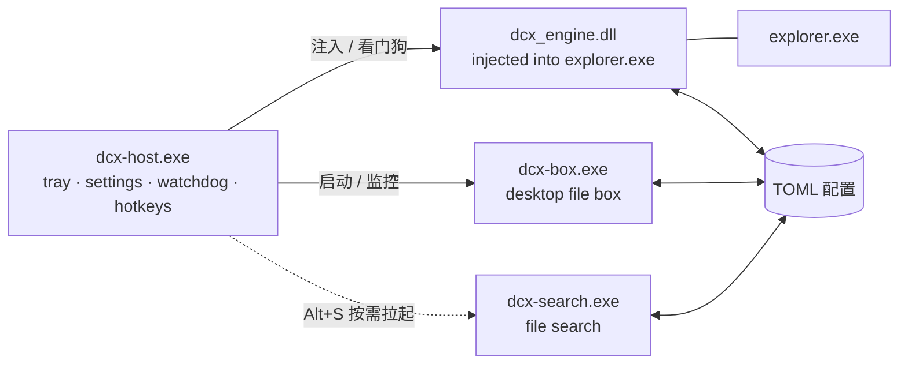

<p align="center">
  
</p>

<h1 align="center">DCX</h1>

<p align="center">
  <b>Windows 11 桌面增强平台</b><br>
  任务栏主题 · 桌面收纳盒 · 文件检索
</p>

<p align="center">
  <a href="https://github.com/gggaiitx/dcx/releases/latest"></a>
  
  
  <a href="LICENSE"></a>
</p>

DCX 是一套用 Rust 编写的 Windows 11 桌面增强平台。它把三件事做成彼此独立的进程：**任务栏主题**、**桌面收纳盒**、**文件检索**。宿主常驻托盘，负责注入看门狗、应用生命周期、全局热键和统一设置中心；应用崩溃不会带走宿主，宿主退出会统一停止应用。

> 当前版本 **v0.1.0**，已在 Windows 11 `10.0.26200` x64 实机验证。任务栏引擎针对当前 Win11 视觉树实现，Windows 大版本更新后可能需要重新核对元素路径。

## 效果

<p align="center">
  
</p>
<p align="center"><sub>任务栏主题与桌面收纳盒按钮</sub></p>

<p align="center">
  
</p>
<p align="center"><sub>桌面收纳盒：应用分类视图</sub></p>

<p align="center">
  
</p>
<p align="center"><sub>文件检索：名称 / 路径 / 大小 / 修改时间</sub></p>

## 功能

| 模块 | 能力 |
|---|---|
| **任务栏主题** | 胶囊 / 卡片两种 dock 形态；图标缩放 50–125%；间距 −6…+6 px；Dock 悬停放大；任务栏高度 30–44 DIP；设置热重载 |
| **桌面收纳盒** | 桌面保持 Explorer 原生显示；收纳 = 物理移入独立库目录；分类、拖拽、右键菜单、库路径修改与迁移；`Alt+D` 唤出 |
| **文件检索** | 文件名 + 内容检索；通配符、空格 AND、`ext:` / `path:` / `regex:` 前缀；名称/路径截断时悬停显示完整内容；默认关闭，`Alt+S` 唤起 |
| **平台** | 托盘、注入看门狗、应用启停、开机自启、Win11 风格设置中心 |

### 任务栏主题

`dcx_engine.dll` 注入 `explorer.exe`，把主题规则写入任务栏 XAML；设置写入 `%LOCALAPPDATA%\dcx\settings.toml` 后，引擎约 1 秒内热重载，无需重启 Explorer。

- 形状：胶囊 / 卡片
- 图标缩放：50–125%
- 图标间距：−6…+6 px
- 悬停：`Background`（只高亮）/ `Dock`（按距离放大并推开相邻图标）
- 任务栏高度：30–44 DIP，托盘与 dock 同步
- 右侧时钟、托盘图标与开始菜单区域的视觉对齐

### 桌面收纳盒

桌面上的文件仍由 Explorer 原生管理；把文件收进盒子时，它会被**物理移动**到收纳库（默认 `文档\dcx收纳`），桌面图标随之消失，文件本身不会删除。把库内项目拖回桌面即恢复原状。

- 分类是收纳库内的虚拟元数据：扩展名规则自动归类，手动拖拽/菜单写入 `organizer.toml`
- 库路径可在「设置 → 桌面整理 → 收纳库目录」修改；修改时会迁移已有文件，并保留手动分类
- 支持列表/网格、排序、搜索、文件夹展开、拖放、右键菜单、新建文件夹、重命名、回收站删除
- 底部「收纳」按钮：单击复制收纳库路径，双击打开收纳库
- 全局快捷键默认 `Alt+D`

### 文件检索

独立进程 `dcx-search.exe`，默认不常驻、不预建索引；首次通过 `Alt+S` 唤起后在后台建立索引，结果边建边出。

- 检索范围：整个电脑 / 自定义文件夹；可配置排除规则
- 模式：文件名 / 内容
- 语法：`*` `?` 通配符、空格表示 AND、`ext:` / `path:` / `regex:` 前缀
- 结果表支持名称、路径、大小、修改时间；截断的名称/路径悬停显示完整文本
- 关闭窗口即释放进程；默认热键 `Alt+S`

## 下载与安装

从 [Releases](https://github.com/gggaiitx/dcx/releases/latest) 下载：

- `DCX-v0.1.0-win64.zip` — 便携包
- `SHA256SUMS.txt` — 二进制校验和

1. 解压整个 `DCX` 文件夹到任意位置（不要只取出 exe，宿主按同目录查找 `dcx-box.exe`、`dcx-search.exe`、`dcx_engine.dll` 和 `wh_injector.exe`）。
2. 运行 `start-dcx.bat`：只留托盘，不弹设置窗口。
3. 或运行 `dcx-host.exe`：默认带设置窗口启动。
4. 首次运行可能被 SmartScreen 提示（构建未签名），选择「更多信息 → 仍要运行」。

系统要求：Windows 11 x64。便携包无需安装；设置和索引写入 `%LOCALAPPDATA%\dcx\`。

## 使用

### 快捷键

| 快捷键 | 动作 |
|---|---|
| `Alt+D` | 打开 / 收起桌面收纳盒 |
| `Alt+S` | 打开文件检索 |

两个热键都可在设置中心修改或关闭；文件检索的快捷键由宿主常驻监听，不依赖检索进程是否已启动。

### 设置中心

托盘左键打开设置，右键菜单包含「设置 / 退出」等操作。设置页分为：

- **任务栏样式**：外观、尺寸与间距、自动隐藏
- **桌面整理**：收纳盒启停、热键、收纳库目录、分类规则
- **文件检索**：启停、热键、检索范围、内容检索策略
- **关于**：运行状态、平台行为、退出

设置改动防抖 220 ms 后原子写入，引擎约 1 秒内热重载；没有「保存」按钮。

### 收纳库与桌面

默认收纳库是系统「文档」目录下的 `dcx收纳`。收纳库是普通目录，可以放到其他磁盘；在设置页修改路径时会先确认，再迁移文件并重建根目录，手动分类记录会跟随迁移。

桌面本身不会被 DCX 隐藏或接管：收纳只改变文件所在位置，不修改文件属性，也不绘制桌面层。

## 架构



- **进程隔离**：宿主负责注入与看门狗，收纳盒和检索是独立 exe；一个应用崩溃不会影响任务栏主题和设置中心。
- **文件即 IPC**：宿主、引擎和应用都通过 `%LOCALAPPDATA%\dcx\` 下的 TOML 文件通信，没有私有共享内存或管道。
- **可扩展应用**：新增独立应用 = 新增 crate + 在 `dcx-host/src/apps.rs` 注册一条 `AppEntry`，不需要改设置窗口的导航结构。

### 组件

| crate / 文件 | 作用 |
|---|---|
| `dcx-host` | 宿主：托盘、注入看门狗、应用生命周期、全局热键、统一设置中心 |
| `dcx-box` | 桌面收纳盒；独立窗口与任务栏按钮 |
| `dcx-search` | 文件检索；名称索引 + 内容流式检索 |
| `dcx-engine` | 注入 Explorer 的任务栏 XAML 主题引擎 |
| `dcx-organizer` | 收纳盒数据层：分类、manifest、桌面扫描与物理移动 |
| `dcx-settings` | 平台设置模型与 TOML 持久化 |
| `dcx-theme` / `dcx-xaml` / `dcx-blur` | 主题规则、XAML 属性系统、合成画刷 |
| `dcx-win32` / `dcx-core` | 手写 Win32 绑定与平台基础层 |

### 目录结构

```text
dcx/
├── crates/
│   ├── dcx-host/          # 宿主 + 设置中心
│   ├── dcx-box/           # 桌面收纳盒
│   ├── dcx-search/        # 文件检索
│   ├── dcx-engine/        # 任务栏引擎 DLL
│   ├── dcx-organizer/     # 收纳盒数据层
│   ├── dcx-settings/      # 设置模型
│   ├── dcx-theme/         # 主题规则
│   ├── dcx-xaml/          # XAML 绑定
│   ├── dcx-blur/          # 合成画刷
│   ├── dcx-win32/         # Win32 绑定
│   └── ...
├── brand/                 # 图标、Logo、预览图
├── docs/                  # 工程笔记
├── tools/                 # 品牌/图标生成与验证脚本
├── prd.md                 # 产品需求与方案
└── README.md
```

## 配置

运行时文件都在 `%LOCALAPPDATA%\dcx\`：

| 文件 | 所有者 | 内容 |
|---|---|---|
| `settings.toml` | 宿主 / 引擎 | 任务栏形状、图标缩放、间距、高度、悬停效果 |
| `organizer.toml` | 宿主 / 收纳盒 | 分类、手动分类、收纳库路径、视图偏好 |
| `search.toml` | 宿主 / 检索 | 快捷键、检索范围、排除规则、索引策略 |
| `apps.toml` | 宿主 | 各独立应用的启停状态 |

这些文件不在仓库里；仓库只包含源码、品牌资源和生成脚本。

## 从源码构建

要求：

- Windows 11 x64
- 稳定版 Rust（edition 2021）
- Windows SDK（生成 exe 图标需要 `rc.exe`；缺失时构建会跳过图标）
- PowerShell（部分验证与发布脚本）

```powershell
git clone https://github.com/gggaiitx/dcx.git
cd dcx
cargo build --release
```

构建产物在 `target\release\`：

- `dcx-host.exe`
- `dcx-box.exe`
- `dcx-search.exe`
- `dcx_engine.dll`

`wh_injector.exe` 是随发布包提供的外部注入器，不由本工作区编译。源码运行时需要把它放到 `dcx-host.exe` 同目录，或通过 `DCX_INJECTOR` 指向它；引擎 DLL 也可通过 `DCX_ENGINE_DLL` 指定。

宿主按自身所在目录查找 `dcx-box.exe` / `dcx-search.exe`，因此从源码运行时要保证这些 exe 与宿主在同一个目录。开发用启动脚本见 `tools/run.ps1`。

### 测试与验证

仓库没有 CI；Windows 相关行为（注入、XAML、DPI、任务栏）需要实机验证。可先运行：

```powershell
cargo test -p dcx-organizer
cargo test -p dcx-search
```

完整的验证项目、历史踩坑和实现细节见 [`docs/engineering-notes.md`](docs/engineering-notes.md)。

## 已知限制

- 任务栏引擎只匹配当前 Windows 11 任务栏 XAML 视觉树；系统大版本更新后可能需要重新核对元素路径。
- `dcx_engine.dll` 注入 `explorer.exe`，属于系统级改动；升级引擎请使用 `update-engine.bat`，不要在 Explorer 运行时直接覆盖 DLL。
- 构建与发布包均未签名，SmartScreen/杀毒软件可能提示；请只从本仓库的 Releases 下载。
- 只处理主任务栏；多任务栏/第三方任务栏壳未适配。
- 不提供安装器；DCX 是便携应用，配置与索引都在 `%LOCALAPPDATA%\dcx\`。
- 任务栏图标放大受 dock 高度裁剪，属于当前实现的视觉边界。

## 文档与许可

- 工程实现、调试记录与历史方案：[docs/engineering-notes.md](docs/engineering-notes.md)
- 产品需求：[prd.md](prd.md)
- 品牌资源生成：`tools/gen_brand.py`、`tools/gen_search_icon.py`
- 手动替换文件前可用：`tools/stop-dcx-all.bat`（源码）/ 发布包内的 `stop-dcx-all.bat`

本项目以 **MIT License** 发布，详见 [LICENSE](LICENSE)。欢迎 Issue 和 PR。
